# Tablecraft

A relaxing jigsaw puzzle game made with Flutter. Runs on Android, iOS and the web from one codebase.

- Package / bundle id: `com.inovexa.tablecraft`
- Developer: Innovexa Technologies, innovexa.technologies01@gmail.com
- Release steps (signing, APK, AAB, store files, Git): see `RELEASE_GUIDE.md`
- Test checklist (including back-button navigation): see `TESTING.md`


<p align="center">
  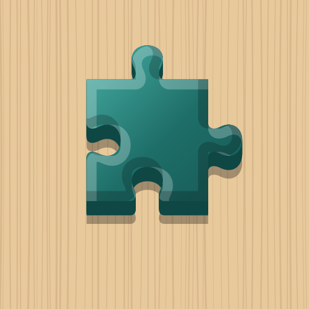
</p>

<p align="center">
  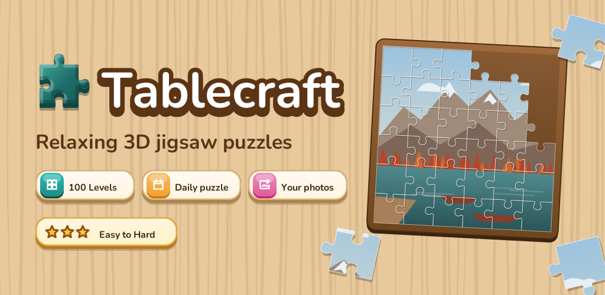
</p>

## App screens

| | | |
|:---:|:---:|:---:|
| 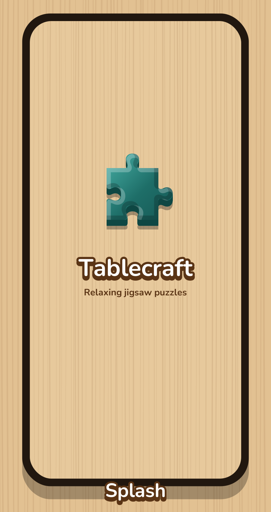 | 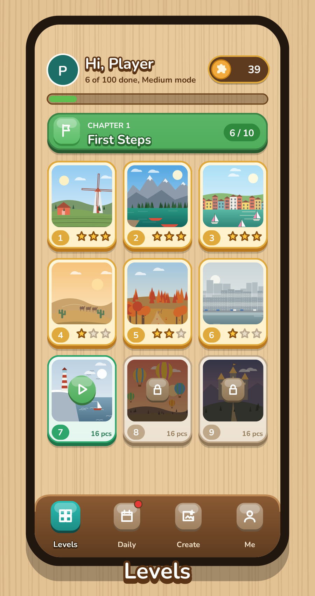 | 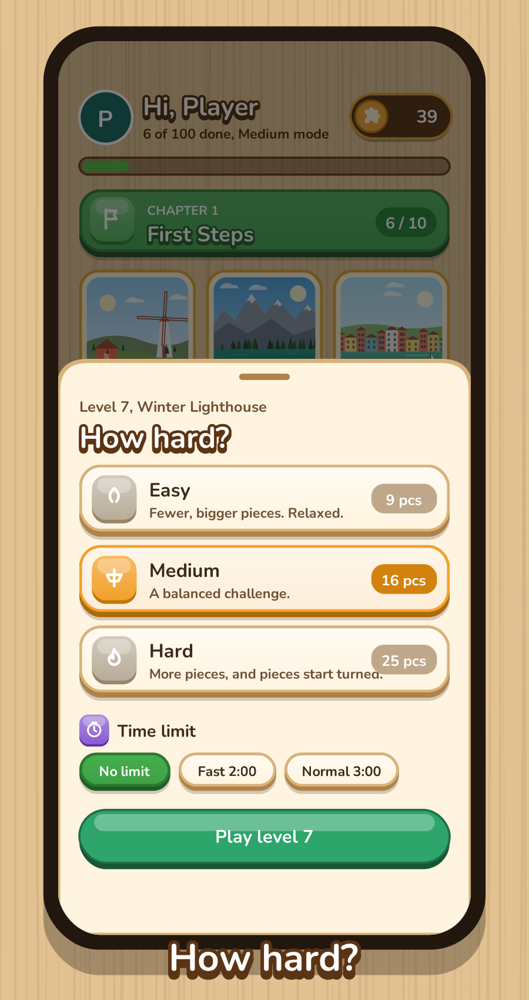 |
| 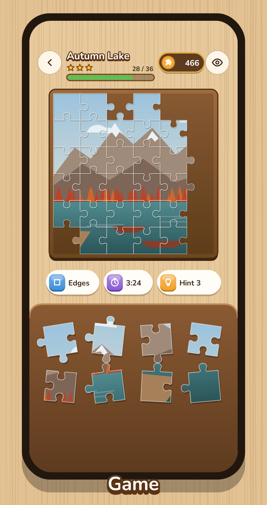 | 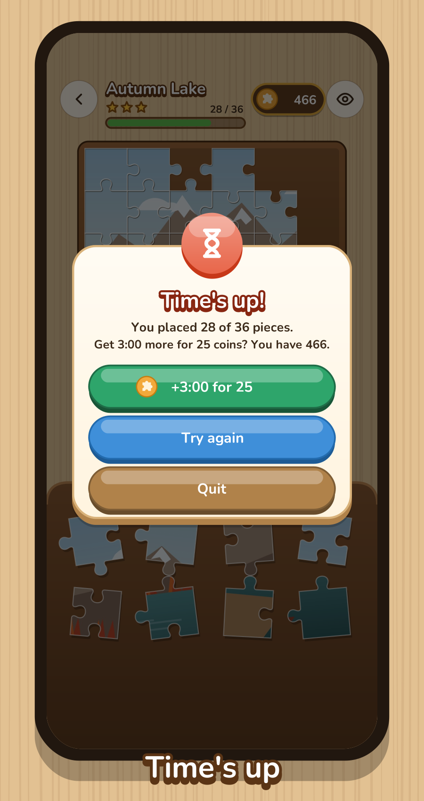 | 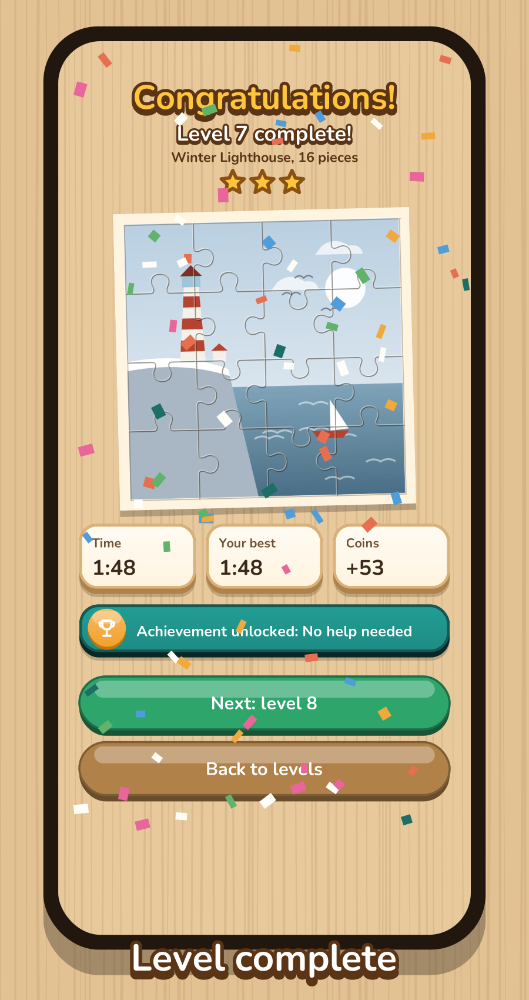 |
| 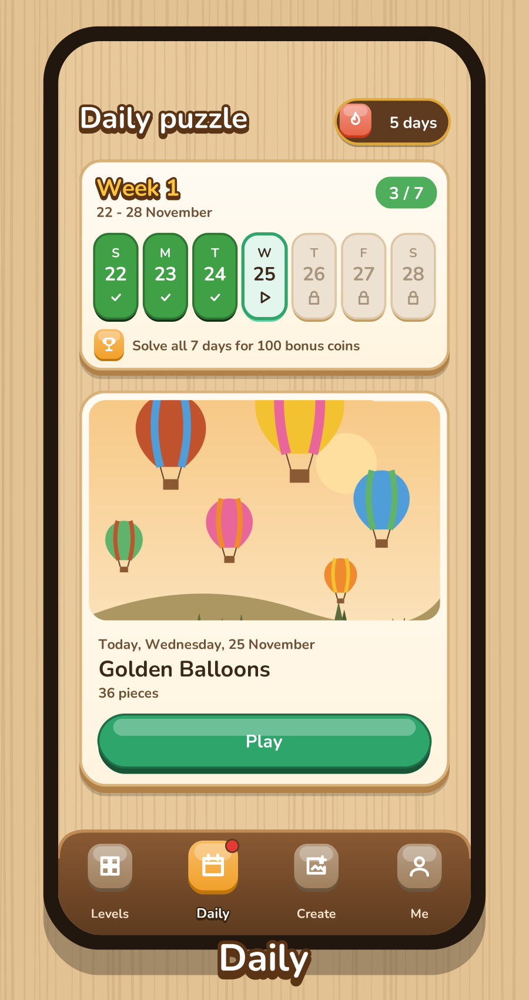 | 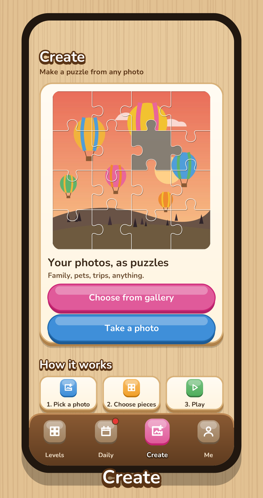 | 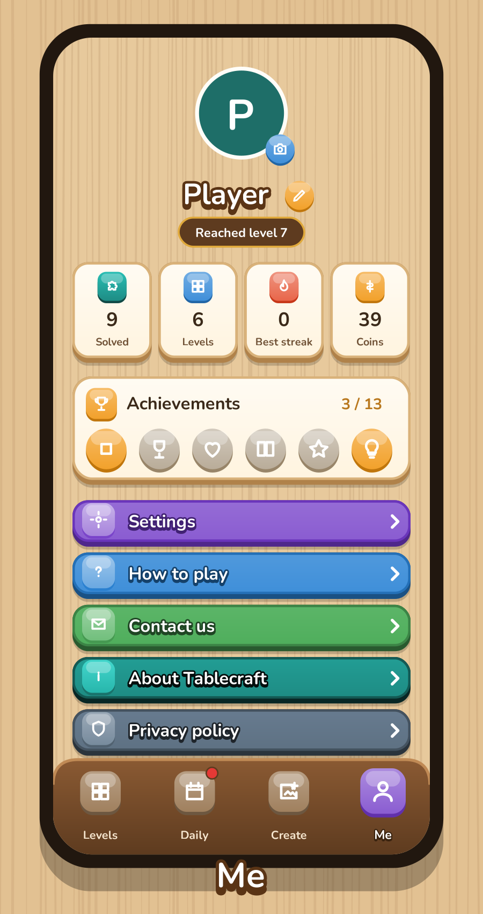 |

## Google Play screenshots (1080 x 1920)

| | | |
|:---:|:---:|:---:|
| 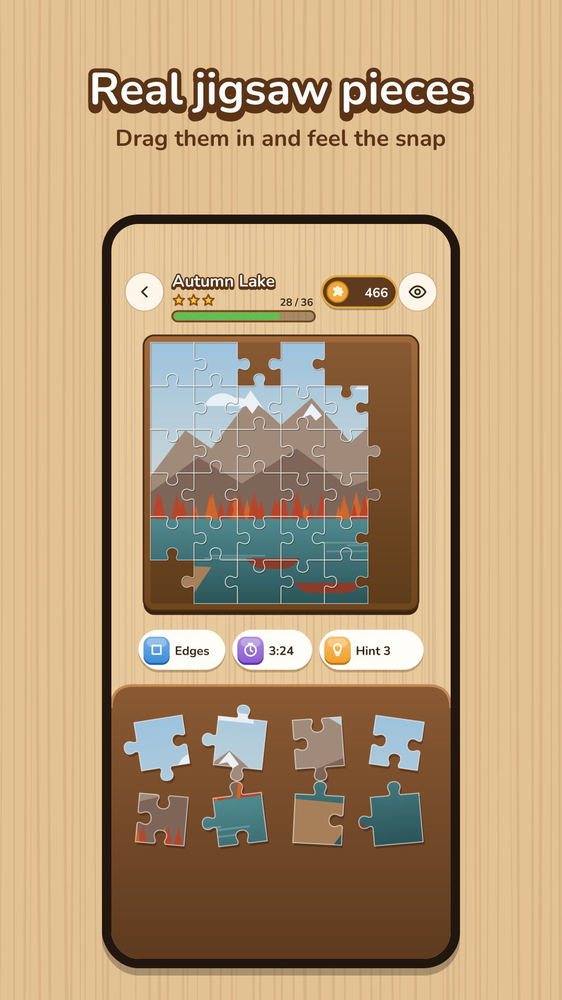 | 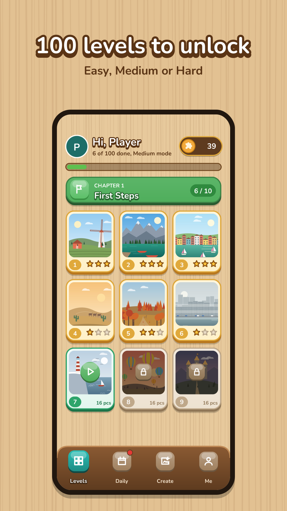 | 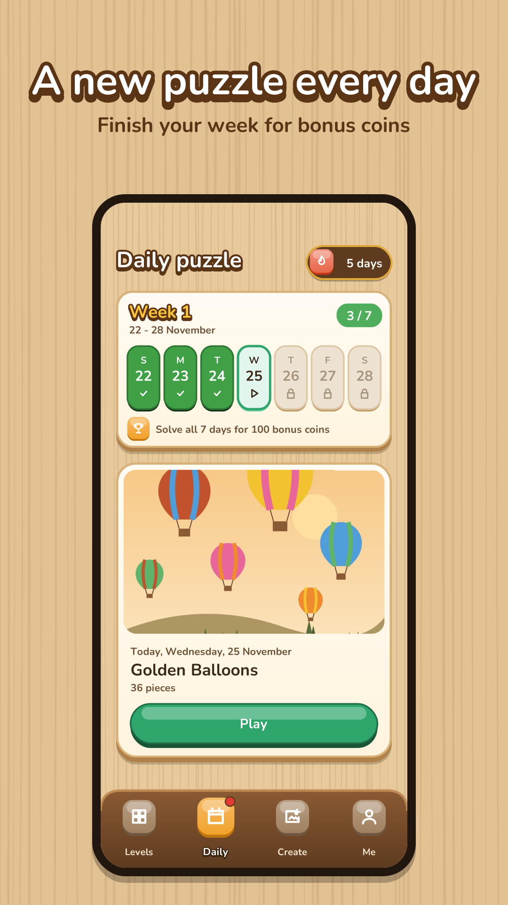 |
| 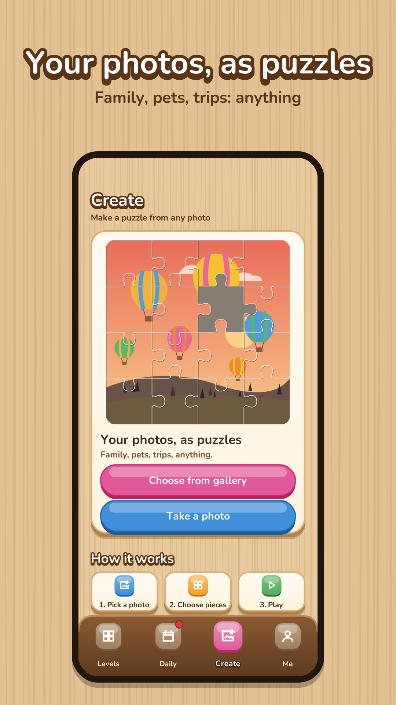 | 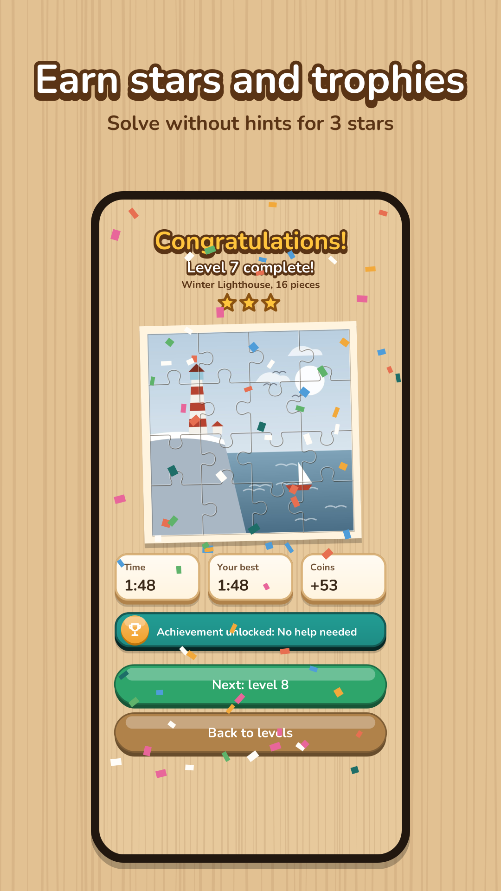 | 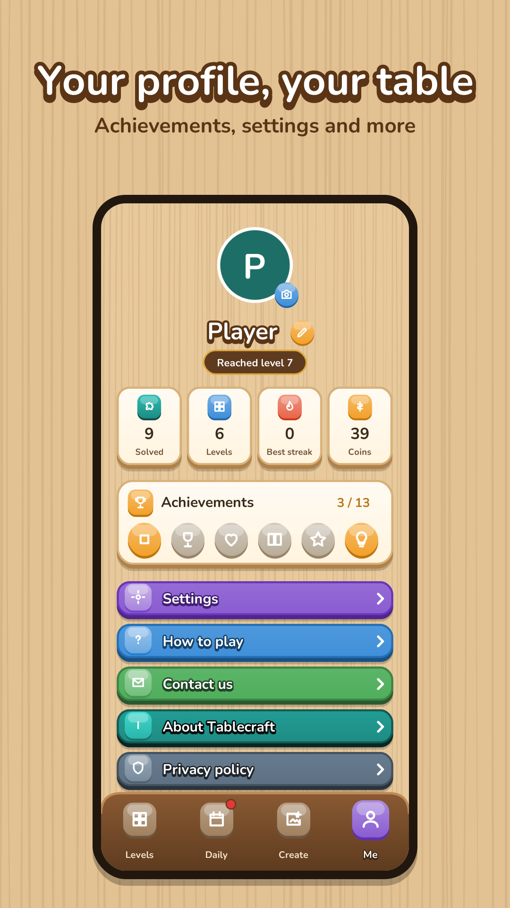 |

## Mockup

<p align="center">
  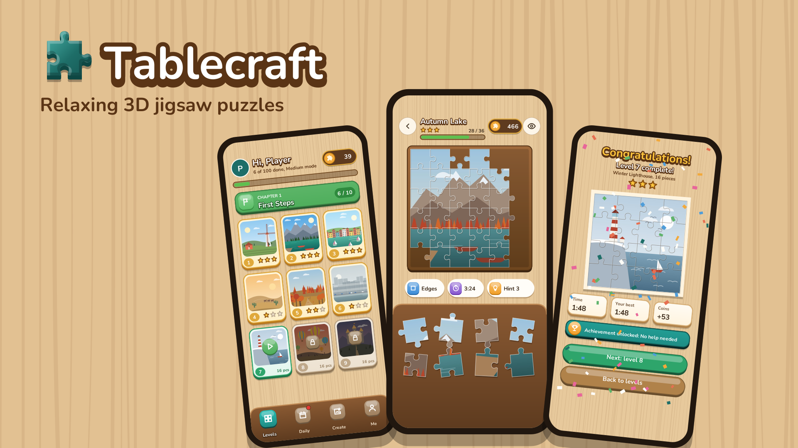
</p>

## Icon preview

<p align="center">
  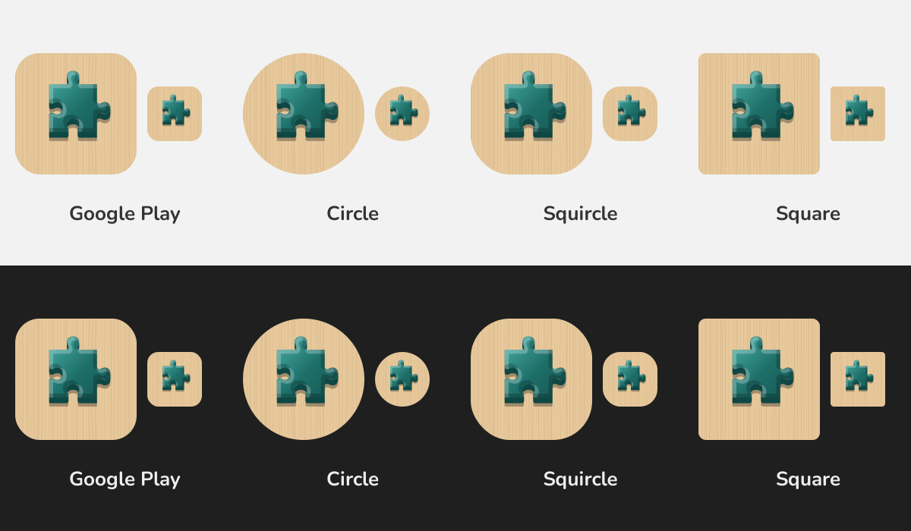
</p>

## First-time setup (once)

```bash
cd tablecraft
flutter create --org com.inovexa --project-name tablecraft --platforms android,ios,web .
flutter pub get
dart run flutter_launcher_icons
dart run flutter_native_splash:create
```

`flutter create .` only adds the missing platform folders (android/, ios/, web/). It does not touch `lib/`.

### App name
- Android: `android/app/src/main/AndroidManifest.xml` → `android:label="Tablecraft"`
- iOS: `ios/Runner/Info.plist` → `CFBundleDisplayName` = `Tablecraft`
- Web: `web/index.html` → `<title>Tablecraft</title>`, and `web/manifest.json` → `"name"` and `"short_name"`

### iOS photo and camera permission (required for the Create tab)
Add inside `<dict>` in `ios/Runner/Info.plist`:

```xml
<key>NSPhotoLibraryUsageDescription</key>
<string>Tablecraft uses your photos to make puzzles from them.</string>
<key>NSCameraUsageDescription</key>
<string>Tablecraft uses the camera so you can take a photo and turn it into a puzzle.</string>
```

## Run

```bash
flutter run                 # Android phone or emulator
flutter run -d chrome       # Web
flutter run -d <iphone-id>  # iOS (needs a Mac with Xcode)
flutter test                # unit tests
```

## Build for release

```bash
flutter build appbundle     # Android → upload to Google Play
flutter build ipa           # iOS → upload to App Store (Mac + Apple developer account)
flutter build web           # Web → upload the build/web folder to any static host
```

## Platform notes
- On the web, a photo from "Use your own photo" stays in memory only, so that puzzle
  cannot be continued after the tab is closed. Built-in puzzles save normally.
- On wide screens (browser, tablet) the app stays phone-width and is centred.

## Folders
- `lib/models`      data classes (Piece, PuzzleInfo, SavedGame)
- `lib/data`        built-in puzzles and table backgrounds
- `lib/game`        game logic: piece shapes, rules, image loading
- `lib/services`    saving data on the device
- `lib/screens`     full screens
- `lib/widgets`     smaller UI parts
- `test`            unit tests
- `tool`            scripts that make the level pictures, sound effects and Play Store graphics
- `release`         signing templates and privacy_policy.html
- `store_assets`    icon, feature graphic, screenshots for Google Play
- `docs/images`     the same pictures, shown in this README

## Pictures
The 100 level pictures are `assets/puzzles/level_01.jpg` ... `level_100.jpg` (made by `tool/make_level_images.py`).
Replace any of them with a real photo of the same name (square is best). Level names and chapters are in `lib/data/levels.dart`.
